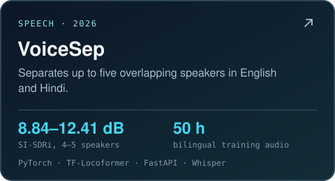
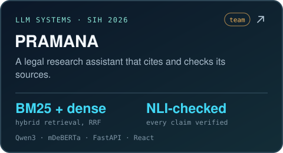
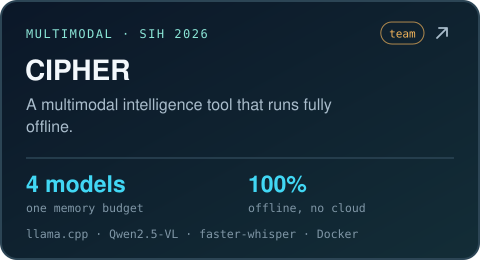
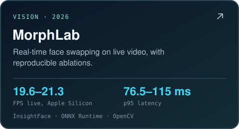

  
  

    <strong>IT student at Delhi Technological University working on machine learning research.</strong> 
    Mostly vision-language models and speech separation, plus full projects built around them. 
    B.Tech IT · GPA <strong>9.40</strong> · AI/ML intern at Deloitte, summer 2026
  

  

    
    
    
    
  

## Research

**Reasoning segmentation for SAR sea-ice imagery** · *paper in preparation* 
Can a vision-language model take a text prompt and segment the right ice in a satellite radar image, including small, scattered floes? I benchmarked 7 language-guided segmentation models, fine-tuned 3B VLMs with GRPO, and built an evaluation protocol with per-class metrics and bootstrap confidence intervals. Now I'm designing an RL reward for the scattered targets existing models miss.

**[Feature drift under domain fine-tuning](https://github.com/Ritwik389/Mechanistic-Interpretability)** · *independent study* 
TopK sparse autoencoders on Pythia-160M before and after fine-tuning on Python code, with features matched by cosine similarity and the Hungarian algorithm to separate expected drift from collateral drift.

## Featured · Jensen Huang Digital Twin

A Jensen Huang chatbot that answers in his voice, with sources. Streamed replies, zero-shot voice cloning, and a clickable map of the ideas behind each answer.

- **Retrieval:** Chroma semantic search and bounded Neo4j graph paths feed a cross-encoder reranker with era-aware filtering.
- **Evaluation:** a 50-question labelled set with era limits, unanswerable and misleading-premise cases. Reranking took Recall@5 from **33.3% to 47.2%** and MRR@5 from **0.248 to 0.394**, at a 1.35 s median latency cost.
- **Voice:** sentence-by-sentence Pocket TTS with zero-shot voice cloning, streaming text and cancellable replies.

  
  
  
  

## More things I've built

  
  

  
  

<strong>Smaller projects</strong>

 

| Project | What it does |
| --- | --- |
| [Analyzing Autoencoders](https://github.com/Ritwik389/Analyzing-Autoencoders) | 8 autoencoder architectures on EMNIST; the best CNN cut validation MSE 99.86% below the ANN baseline. |
| [Anomaly Detection Pipeline](https://github.com/Ritwik389/anomaly-detection-pipeline) | VideoMAE scoring, then Gemma multimodal review, then Telegram alerts. |
| [SEOAuditor](https://github.com/Ritwik389/SEOAuditor_TinyFish) | An evidence-first AI search visibility auditor, built for TinyFish × AIMS-DTU. |
| [Desktop Gesture Control](https://github.com/Ritwik389/Gesture-based-desktop-control-system) | Personalised gestures learned from 50 frames, with 90% recognition accuracy. |
| [AI Stadium Command Centre](https://github.com/Ritwik389/AI-Stadium-Command-Centre) | YOLOv8 crowd analytics from CCTV, with a zone-drawing GUI. |
| [Snowball](https://github.com/Ritwik389/Snowball) | Turns goals into AI micro-tasks ranked by urgency × importance. |
| [Drone Gesture Classification](https://github.com/Ritwik389/drone-gesture-classfication) | Webcam hand gestures mapped to drone commands. |

## Experience

- **AI/ML Intern, Deloitte** (Apr – Jul 2026): built multiclass classification pipelines on SageMaker, Glue, S3 and Athena, and moved 10+ notebook workflows into automated AWS Glue jobs.
- **Open source:** [pgmpy #3739](https://github.com/pgmpy/pgmpy/pull/3739) (BDeu/BDs validation fix) and [neural-lam #893](https://github.com/mllam/neural-lam/pull/893) (datastore CLI docs fix).

## Achievements

- 🏆 **Visionary Award**, Open Scientific Intelligence Hackathon 2026
- 🥈 **2nd prize, GreenTag** at APOGEE ’26, BITS Pilani: led a 5-member team, 2nd of 20+ teams.
- **Smart India Hackathon 2026**: both my teams, PRAMANA and CIPHER, cleared the DTU internal round.

## Tech stack

  

Also Hugging Face Transformers, ONNX Runtime, MediaPipe, Chroma, Neo4j, PySpark and SQL.

## GitHub activity

  <a href="https://github.com/Ritwik389">
    <picture>
      <source media="(prefers-color-scheme: dark)" srcset="https://streak-stats.demolab.com/?user=Ritwik389&amp;theme=github-dark-blue&amp;hide_border=true&amp;disable_animations=true" />
      
    </picture>
  </a>

  

